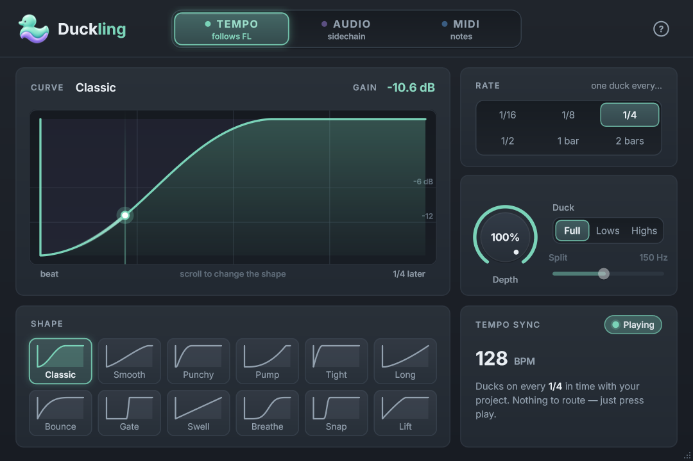

# Duckling

A sidechain / volume-ducking plugin for FL Studio (and any VST3 / CLAP host): the classic "pumping" effect in one
click, without wrestling with Fruity Limiter. Part of the same family as Chordbloom and RefMatch.



## What it does

Pick **what** triggers the duck, **which shape** it has and **how long** it lasts:

| Trigger | How it works | Routing needed |
| --- | --- | --- |
| **Tempo** | Ducks on every Rate step (1/16 ... 2 bars) of your project's song position | none - just play |
| **Audio** | Ducks whenever a sidechain signal (your kick) crosses the threshold | "Sidechain to this track" + wrapper Processing tab |
| **MIDI** | Ducks on every note it receives - draw your own duck pattern | a MIDI Out channel + wrapper MIDI input port |

- **12 curve shapes**: Classic, Smooth, Punchy, Pump, Tight, Long, Bounce, Gate, Swell, Breathe, Snap, Lift.
  Click a thumbnail or scroll over the big curve.
- **Depth**: how far the volume dips (100 % = silence).
- **Duck: Full / Lows / Highs**: duck the whole sound, only the low end (Linkwitz-Riley split, 40 Hz - 1 kHz) or
  only the top.
- Live playhead, gain readout, sidechain meter with a draggable threshold, MIDI note activity.
- No latency, no allocations on the audio thread, click-free gain smoothing (0.8 ms attack / 2 ms release).
- Resizable window (75 % - 200 %), fits next to FL Studio on a 1080p screen at the default 720 x 480.

The **?** button in the plugin shows the FL Studio routing steps for each trigger; they are also in
[installer/QuickStart.txt](installer/QuickStart.txt).

## Install

Run `dist\Duckling-Setup-<version>.exe` (built by `scripts\build-installer.bat`), or from a development build:

```
powershell -ExecutionPolicy Bypass -File scripts\install-plugin.ps1
```

Then in FL Studio: Options > Manage plugins > Find installed plugins, and add Duckling to a mixer track.

## Build

Windows, Visual Studio 2022 (C++ workload), CMake >= 3.22 and Ninja. JUCE 8 goes in `third_party/JUCE`;
`scripts\fetch_clap.bat` fetches clap-juce-extensions for the CLAP build.

```
scripts\build.bat build Duckling_VST3 Duckling_CLAP CoreTests DucklingDev
build\CoreTests.exe                                   # pure C++ curve / engine tests
build\DucklingDev_artefacts\Release\DucklingDev.exe selftest          # processor integration tests
build\DucklingDev_artefacts\Release\DucklingDev.exe snapshot out\snap # editor screenshots
scripts\build-installer.bat                           # static-runtime release build + Inno Setup installer
```

## Layout

- `src/core` - curves and the ducking engine (pure C++17, no JUCE)
- `src/plugin` - the JUCE AudioProcessor (buses, parameters, band split, state)
- `src/ui` - editor, panels and the shared look (Theme / Widgets)
- `tests` - core unit tests; `tools/dev` - self-test and snapshot renderer
